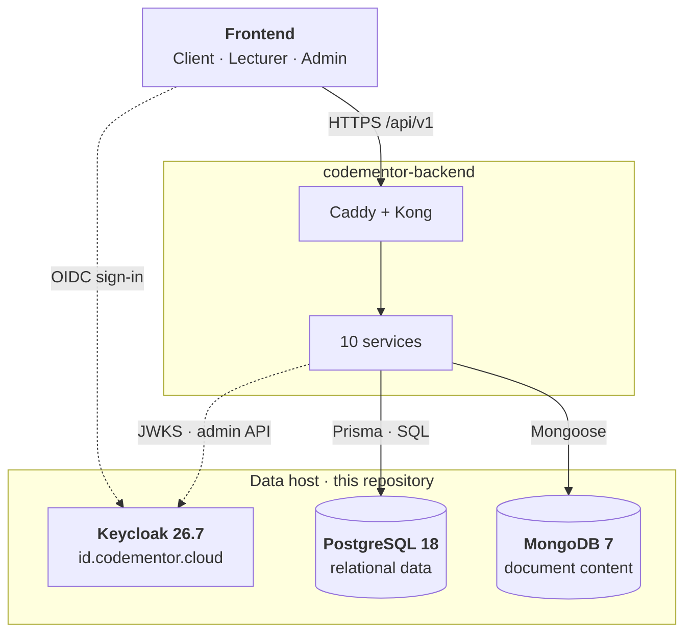
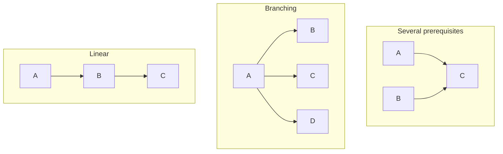
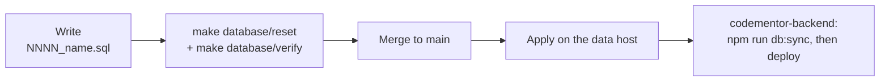

<div align="center">

<picture>
  <source media="(prefers-color-scheme: dark)" srcset=".github/assets/logo-dark.png">
  
</picture>

<h1>CodeMentor Infrastructure</h1>

<p>
  <strong>The data layer and identity stack of CodeMentor</strong> — the PostgreSQL schema and its
  migrations, MongoDB collections, Keycloak, and the host that runs them.
</p>

<p>
  
  
  
  
  
  
</p>

<p>
  <a href="#getting-started">Getting started</a> ·
  <a href="#migrations">Migrations</a> ·
  <a href="docs/07-use-case-model.md">Use-case model</a> ·
  <a href="#contributing">Contributing</a>
</p>

</div>

---

## Table of contents

1. [About](#about)
2. [Architecture](#architecture)
3. [Repository layout](#repository-layout)
4. [Getting started](#getting-started)
5. [Database](#database)
6. [Migrations](#migrations)
7. [Keycloak](#keycloak)
8. [Production host](#production-host)
9. [Documentation](#documentation)
10. [Contributing](#contributing)
11. [Related repositories](#related-repositories)

## About

This repository holds infrastructure only — no application code. It is the **single owner of the
database schema**: the backend reads the schema through Prisma introspection and never migrates it.
Every schema change is a new, numbered SQL migration here.

| Area | What it provides |
| --- | --- |
| [`database/`](database) | PostgreSQL migrations, seed data and invariant checks; MongoDB collection validators, indexes and seed |
| [`docker/`](docker) | The data host stack — PostgreSQL 18, MongoDB 7, Keycloak 26.7 — with bootstrap, migration, realm and verification scripts, and the Keycloak login themes |
| [`docs/`](docs) | Actors, use-case model and use-case specifications, with rendered UML diagrams |

## Architecture



Two kinds of data, two stores:

| Store | Holds | Why |
| --- | --- | --- |
| **PostgreSQL** | Accounts, learning paths, courses, lessons, enrollment and progress, exercises, study groups, submissions, commerce ledger, notifications, reports and moderation | Relationships and invariants that must hold — enforced with constraints and triggers |
| **MongoDB** | Lesson, exercise and article content, submission run details, notifications, AI sessions, documents and RAG index | Content whose shape varies and is read as a whole document |

## Repository layout

```text
codementor-infra/
├── database/
│   ├── postgres/
│   │   ├── migrations/        41 numbered, append-only SQL migrations
│   │   ├── seed/              development seed data
│   │   └── verify.sql         invariant and dependency-guard checks
│   ├── mongo/
│   │   ├── schemas/           collection validators and indexes (10 collections)
│   │   └── seed/
│   ├── scripts/               init, catalog dump, schema-reference generator
│   ├── docs/                  domain model, dependency model, design decisions, schema reference
│   └── Makefile
├── docker/
│   ├── docker-compose.dev.yml PostgreSQL + MongoDB + Keycloak
│   ├── keycloak/themes/       login themes: codementor, codementor-web, codementor-lecturer
│   ├── scripts/               bootstrap, migrate, realm configuration, stack verification
│   ├── docs/
│   └── Makefile
├── docs/                      use-case documentation and diagrams
├── scripts/                   diagram rendering
└── Makefile                   dispatcher only — discovers */Makefile
```

## Getting started

**Prerequisites:** Docker with Compose, GNU Make, and `psql` / `mongosh` for ad-hoc queries.

```bash
cp database/.env.example database/.env      # local credentials with safe defaults
make database/up                            # start PostgreSQL + MongoDB
make database/init                          # apply migrations and Mongo schemas
make database/seed                          # load development data
make database/verify                        # run the invariant checks
```

The root `Makefile` does no work itself; it discovers every `*/Makefile` and dispatches to it.

| Command | What it does |
| --- | --- |
| `make help` | List targets and discovered areas |
| `make database` · `make docker` | Show one area's help |
| `make database/psql` · `make database/mongosh` | Open a database shell |
| `make database/reset` | Rebuild the stack from scratch |
| `make database/schema-doc` | Regenerate `database/docs/05-schema-reference.md` from the SQL comments |
| `make docker/migrate` | Apply pending migrations on the data host |
| `make docker/configure-realm` | Configure the CodeMentor Keycloak realm |
| `make docker/verify` | Verify the running data host stack |
| `make up \| down \| init \| seed \| verify \| reset` | Broadcast to every area that defines the target |

## Database

### Integrity lives in the database

The schema enforces its rules itself, not only in application code:

- **Foreign keys, unique and CHECK constraints** — for example, published content must have a body,
  and a group has exactly one owner.
- **Triggers and PL/pgSQL functions** — prevent dependency cycles, keep cached progress and counters
  in sync, keep the commerce ledger balanced and immutable.
- **`verify.sql`** asserts these invariants against a freshly rebuilt database.

These objects are why the backend must never run `prisma migrate`: it would drop them.

### Display order is not a learning dependency

The learning model stores the order in which content is shown separately from what must be
completed first, so a course can be linear, branching, have several prerequisites, or be fully
free — without duplicating content.



Each learner can switch a course between **sequential**, **graph** and **free** mode; the unlock
check `fn_lesson_available()` reads that choice.

### MongoDB collections

| Collection | Contents |
| --- | --- |
| `exercise_contents` · `lesson_contents` · `article_contents` | Statements, test cases, hints, lesson and article bodies |
| `submission_run_details` | Per-test output, time and memory (expires after 180 days) |
| `notifications` · `notification_reads` | In-app notifications and read state |
| `ai_documents` · `ai_rag` · `ai_agent_sessions` · `ai_call_events` | AI documents, RAG index, assistant sessions, usage telemetry |

## Migrations



- **Append-only.** Add a new numbered file (`0042_…`); never edit a migration that has been applied.
- **Idempotent where possible** (`IF NOT EXISTS`, guarded `DO` blocks) and wrapped in a transaction.
- **Apply before deploying** the backend version that depends on the change.
- **Verify** every change with `make database/verify` against a freshly rebuilt stack
  (`make database/reset`).

`docker/scripts/migrate-postgres.sh` applies pending files and records each in
`infra_schema_migrations`. On the production host some migrations were applied by hand and are not
recorded there; compare the table with the database before running the script, and apply a single
migration with `psql -f` when in doubt.

## Keycloak

Keycloak is the identity provider for the three frontend applications and the backend.

| Item | Where |
| --- | --- |
| Realm configuration | `docker/scripts/configure-codementor-realm.sh` |
| Login themes | `docker/keycloak/themes/` — `codementor`, `codementor-web` (popup sign-in), `codementor-lecturer` |
| Login event logging | `docker/scripts/enable-keycloak-login-events.sh` |
| Operations guide | [`docker/docs/keycloak.md`](docker/docs/keycloak.md) |

Theme caching is disabled, so a changed theme file takes effect without a restart. Because the
bind mount is resolved by inode, restart the container after a `git pull` that replaces a mounted
file.

## Production host

The data host runs PostgreSQL, MongoDB and Keycloak from `docker/docker-compose.dev.yml` on AWS EC2.
Keycloak binds to loopback and is published over TLS at `https://id.codementor.cloud`.

> **Security:** read [`docker/README.md`](docker/README.md) before changing the host. It records
> which ports are reachable from the Internet and how to close them. After any change, run
> `docker/scripts/verify-stack.sh` and confirm the listening addresses with `sudo ss -lntp`.

## Documentation

| Document | Covers |
| --- | --- |
| [`database/docs/00-frontend-review.md`](database/docs/00-frontend-review.md) | How the frontend's data shapes informed the schema |
| [`database/docs/01-domain-model.md`](database/docs/01-domain-model.md) | Entities, relationships, progress strategy |
| [`database/docs/02-dependency-model.md`](database/docs/02-dependency-model.md) | The prerequisite mechanism |
| [`database/docs/03-mongodb-model.md`](database/docs/03-mongodb-model.md) | Collections, document shapes, indexes |
| [`database/docs/04-design-decisions.md`](database/docs/04-design-decisions.md) | Trade-offs and their costs |
| [`database/docs/05-schema-reference.md`](database/docs/05-schema-reference.md) | Every table, column and constraint — generated, do not edit by hand |
| [`docs/06-actors.md`](docs/06-actors.md) | Actors and role model |
| [`docs/07-use-case-model.md`](docs/07-use-case-model.md) | 70 use cases in 9 packages, with diagrams and traceability to the database |
| [`docs/08-use-case-specifications.md`](docs/08-use-case-specifications.md) | Detailed specifications and business rules |
| [`docker/README.md`](docker/README.md) | The data host: services, ports, operations |

Diagrams in `docs/` are PlantUML rendered to SVG; after editing a diagram, run
`node scripts/render-diagrams.js`.

## Contributing

1. **Branch** from `main`: `feat/<topic>`, `fix/<topic>`, `docs/<topic>`, `chore/<topic>`.
2. **Commit** with [Conventional Commits](https://www.conventionalcommits.org/) and a scope —
   for example `feat(db): suspension end time on report moderation actions`.
3. **Check locally** before opening a pull request:

   ```bash
   make database/reset && make database/verify
   ```

4. **Open a pull request** and fill in the [template](.github/pull_request_template.md), including
   how the migration is applied in production and whether it is reversible.
5. Never commit secrets. Every variable is listed in the area's `.env.example` with a safe
   development default.
6. Keep each area self-contained: its own `Makefile`, `README.md` and `docs/`. The root `Makefile`
   only dispatches.

## Related repositories

| Repository | Contents |
| --- | --- |
| **codementor-backend** | NestJS and Python services that read this schema |
| **codementor-frontend** | The client, lecturer and admin applications |
