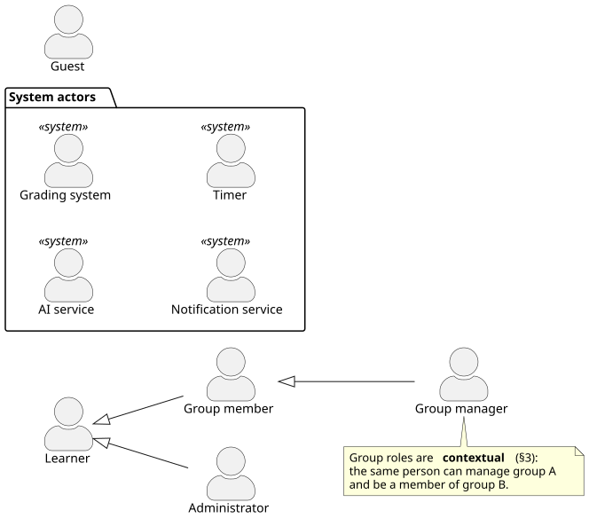
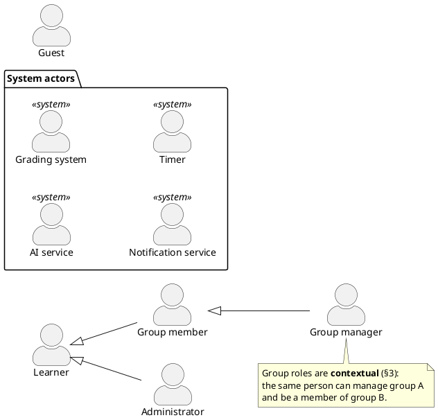

# Actor model

**5 primary actors + 4 system actors.** Every actor must meet two conditions at once: it has **its
own goal**, and it has **a use case no other actor has**. If it fails either, merge it or drop it.

## 1. Actors

### Primary actors

| # | Actor | Inherits | Own goal | Data mapping |
| --- | --- | --- | --- | --- |
| A1 | **Guest** | — | Learn about the platform, create an account | *(no record yet)* |
| A2 | **Learner** | — | Study, practise, track progress | `users`, default `platform_role='learner'` |
| A3 | **Group member** | A2 | Study with a group: receive assignments, share documents | `group_members.role='member'` |
| A4 | **Group manager** | A3 | Run the group: assign work, review, grant permissions | `group_members.role IN ('deputy','owner')` |
| A5 | **Administrator** | A2 | Operate the platform: users, official content, moderation | `platform_role='admin'` |

### System actors (supporting)

They initiate nothing — the system calls them to complete a use case. Drawn **to the right** of the
system boundary.

| # | Actor | Called in | Data mapping |
| --- | --- | --- | --- |
| S1 | **AI service** | Q&A, error analysis, document pre-checks, exercise drafts | `ai_verdict`, `exercises.source='ai'` |
| S2 | **Grading system** | Trial runs, submissions | `submissions.verdict/runtime_ms/memory_kb`, `submission_run_details` |
| S3 | **Notification service** | Email verification, study reminders, due-date reminders | `users.email_verified_at`, `reminders_enabled` |
| S4 | **Timer** («Time») | Triggers scheduled tasks | `study_schedule_slots`, `group_exercises.due_at` |

## 2. Inheritance diagram

<!-- diagram:actor-hierarchy -->

PlantUML source — edit here, then run <code>node scripts/render-diagrams.js</code>

<!-- /diagram:actor-hierarchy -->

`Administrator ⊳ Learner` is deliberate: an admin account can still study, so it inherits every
learner use case instead of re-linking them from scratch.

## 3. Platform role ≠ contextual role

The point most likely to be challenged. The system has **two fundamentally different kinds of
role**:

| | Stored in | Nature | Modelling consequence |
| --- | --- | --- | --- |
| Platform role | `users.platform_role` | **Permanent** — tied to the account | Actor inheritance means a true "is a" |
| Group role | `group_members.role` | **Contextual** — per group | Actor inheritance holds only *relatively* |

Actor inheritance in UML means a permanent *"is a"*. A `Group manager` **is not a kind of person** —
it is *a learner currently playing that role in a specific group*. Therefore:

- Read actors A3/A4 as **"a learner in role X in group Y"**.
- Actual permissions are **not** decided by the actor type but by `group_role_permissions`
  (defaults per role, configurable per group) overlaid with `group_member_permissions`
  (per-person overrides).
- So **every group use case is guarded by a permission precondition**, not by the actor.

This is why the schema has two permission layers: two deputies in the same group can have entirely
different permissions — something a pure role-based model cannot express.

## 4. Primary or supporting actor?

| | Primary actor | Supporting actor |
| --- | --- | --- |
| Role | *Initiates* a use case to reach its goal | The system *calls* it to complete a use case |
| Drawn on | the left | the right |

**AI is not a primary actor** — it never initiates anything:

| Situation | Who initiates | What the AI does |
| --- | --- | --- |
| Assistant Q&A | Learner | Answers |
| Document pre-check | The member uploading a file | Analyses it, returns `ai_verdict` |
| Exercise draft | The author | Generates content |
| Personalised suggestions | Learner opening the page | Ranks |

## 5. Decision log

### Merged

| From | Into | Reason |
| --- | --- | --- |
| `User` *(abstract)* + `Learner` | **`Learner`** | Every account is a `learner` by default; an abstract parent with only 2–3 children is a redundant layer |
| `Group owner` + `Group deputy` | **`Group manager`** | Both share the goal of *running the group* and the same use cases. The difference is a **configurable permission level**, and per §3 permissions are not a criterion for separating actors |

The three things only the owner can do (grant permissions, transfer ownership, dissolve the group)
become the **precondition** `group_members.role = 'owner'`, not a separate actor. The "exactly one
owner per group" rule is still enforced by the database through `uq_group_members_single_owner`.

### Dropped

| Actor | Why |
| --- | --- |
| **Lecturer** | At the time of this analysis there was no separate interface, permission or goal: `/create-problem` was shown to **every** user and the schema did not require `exercises.author_id` to be a mentor. Official content was the Administrator's. `courses.instructor_id` stayed — **lecturers existed as display data, not as an actor** |
| **Moderator** | Moderation is a *responsibility* of the Administrator (platform) and the Group manager (group), not a kind of user. `platform_role` has no such value either |
| **Recruiter** | `companies` is only a label on exercises, with no account or behaviour |
| **Payment system** | The product had no paid model at the time — functionality that does not exist is not modelled |

> Both the lecturer app and paid courses were added later; this log records the decisions as they
> were made for this model.

### Added to the original proposal

| Actor | Evidence that it must exist |
| --- | --- |
| **Guest** | `/`, `/login`, `/signup` — without it, *Sign up / Sign in* would belong to no one |
| **Grading system** | `submissions.verdict/runtime_ms/memory_kb`, `exercises.time_limit_ms`, `submission_run_details.judge{worker,imageTag}` — without it, nothing explains who produces the verdict |
| **Notification service** | `users.email_verified_at`, `reminders_enabled/reminder_time` |
| **Timer** | `study_schedule_slots(weekday, start_time)` + index `idx_study_schedule_due` — study reminders are a **time-triggered** use case, not something the user clicks |
