# Use case model

Built from [`06-actors.md`](06-actors.md) and checked against the frontend's real routes and the
deployed schema. Every use case below traces back to a real screen or table — none is drawn just
to fill the diagram.

The diagrams are **pre-rendered to SVG**, so they display everywhere (VSCode, GitHub, Word, PDF).
The PlantUML source sits in the `
` block under each image — after editing, run
`node scripts/render-diagrams.js`. Mermaid **does not support** use case diagrams, so it is not used
here.

---

## 1. Notation

Use this section as a checklist when redrawing in Visual Paradigm — these are also the most common
mistakes.

### 1.1 Arrow direction

| Relationship | Notation | Arrow direction | Meaning |
| --- | --- | --- | --- |
| **«include»** | dashed line + open arrow | **Base → Included** | Mandatory, always runs. The base is *incomplete* without it |
| **«extend»** | dashed line + open arrow | **Extension → Base** ⚠️ | Optional, conditional. The base is *still complete* without it |
| **Generalization (actor/UC)** | solid line + hollow triangle | **Child → Parent** | "is a" |
| **Association** | solid line, no arrow | Actor — UC | The actor takes part in the use case |

> ⚠️ The `«extend»` arrow **runs against intuition**: it points *at* the base use case, not out of
> it. This is the most common mistake.

### 1.2 Principles applied

1. **Use `«include»` only when truly mandatory.** *Check unlock conditions* always runs when a
   lesson opens → include. *Search* is optional, since a list works without it → **extend**.
2. **Every `«extend»` needs a condition (guard) and an extension point.** Without a condition it is
   not an extend.
3. **Do not split CRUD into 4 use cases.** *Manage members* is one use case with several flows, not
   separate Add/Edit/Delete/View — splitting only clutters the diagram without adding information.
4. **A use case is an actor's goal**, not an interaction step. *"Click Submit"* is not a use case;
   *"Submit a solution and get the grading result"* is.
5. **Supporting actors go on the right** of the system, primary actors on the left.

---

## 2. Package overview

| Package | Code | Use cases | Primary actors |
| --- | --- | --- | --- |
| Account & personalisation | P1 | 8 | Guest, Learner |
| Discovery & learning paths | P2 | 7 | Learner |
| Learning | P3 | 8 | Learner |
| Practice & grading | P4 | 11 | Learner |
| Content authoring & management | P5 | 10 | Administrator, Learner |
| Study groups | P6 | 12 | Group member, Group manager |
| AI assistant | P7 | 5 | Learner |
| System administration | P8 | 6 | Administrator |
| Automated tasks | P9 | 3 | Timer |
| | | **70** | |

<!-- diagram:package-overview -->
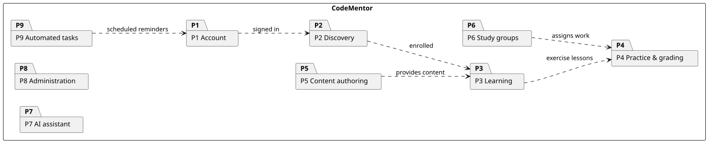

PlantUML source — edit here, then run <code>node scripts/render-diagrams.js</code>

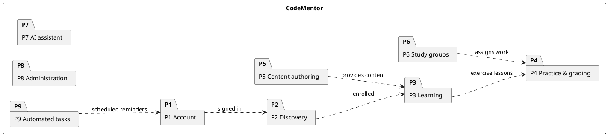

<!-- /diagram:package-overview -->

---

## 3. P1 — Account & personalisation

<!-- diagram:p1-account -->
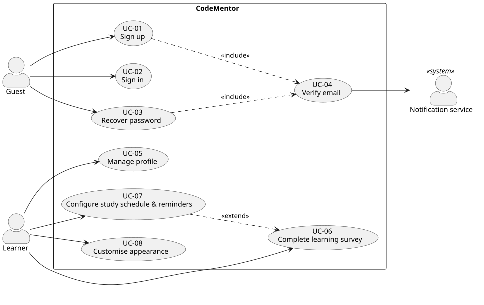

PlantUML source — edit here, then run <code>node scripts/render-diagrams.js</code>

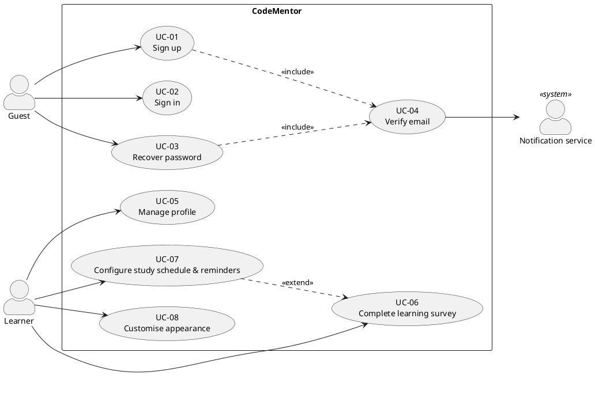

<!-- /diagram:p1-account -->

| Code | Use case | Actor | Notes / data |
| --- | --- | --- | --- |
| UC-01 | Sign up | Guest | `users`; «include» UC-04 |
| UC-02 | Sign in | Guest | `users.password_hash` |
| UC-03 | Recover password | Guest | «include» UC-04 |
| UC-04 | Verify email | *(included)* | `users.email_verified_at`; calls the Notification service |
| UC-05 | Manage profile | Learner | `users.display_name/bio/avatar_url/handle` |
| UC-06 | Complete learning survey | Learner | `learning_preferences` — input for recommendations |
| UC-07 | Configure study schedule & reminders | Learner | `study_schedule_slots`, `reminders_enabled` |
| UC-08 | Customise appearance | Learner | theme (client-side) |

**Extension point** — UC-07 *extends* UC-06 at "after the survey is saved", condition
`remindersEnabled = true`.

---

## 4. P2 — Discovery & learning paths

<!-- diagram:p2-discovery -->
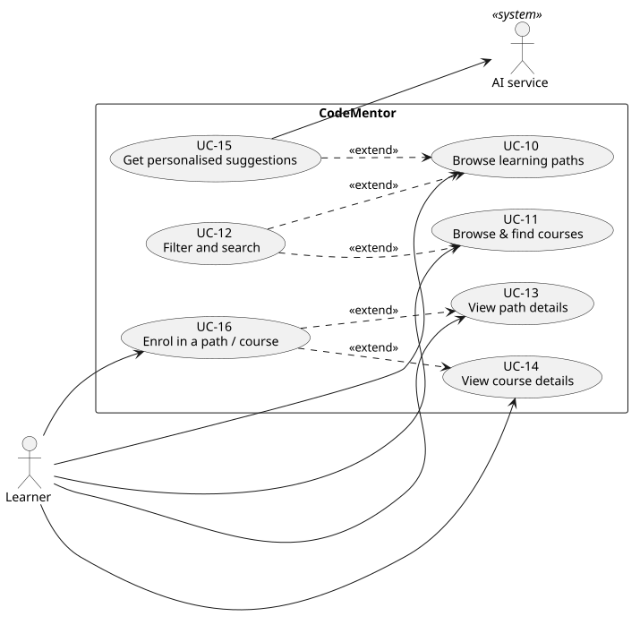

PlantUML source — edit here, then run <code>node scripts/render-diagrams.js</code>

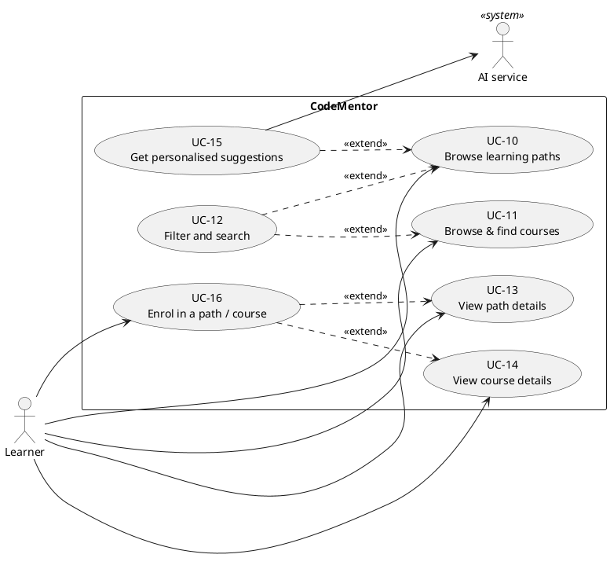

<!-- /diagram:p2-discovery -->

| Code | Use case | Actor | Relationship | Data |
| --- | --- | --- | --- | --- |
| UC-10 | Browse learning paths | Learner | | `roadmaps` |
| UC-11 | Browse & find courses | Learner | | `courses` |
| UC-12 | Filter and search | Learner | «extend» UC-10, UC-11 — *cond: a keyword is entered or a filter chosen* | `technologies`, `tags` |
| UC-13 | View path details | Learner | | `roadmap_courses`, `roadmap_outcomes` |
| UC-14 | View course details | Learner | | `chapters`, `lessons`, `course_reviews` |
| UC-15 | Get personalised suggestions | Learner | «extend» UC-10 — *cond: `learning_preferences.completed_at IS NOT NULL`* | `learning_preferences` |
| UC-16 | Enrol in a path / course | Learner | «extend» from UC-13/UC-14 — *cond: "Start learning" is clicked* | `roadmap_enrollments`, `course_enrollments` |

> UC-12 is an **extend, not an include**: opening the paths page without filtering is still a
> complete flow. It is very often drawn wrongly as an include.

---

## 5. P3 — Learning

<!-- diagram:p3-learning -->
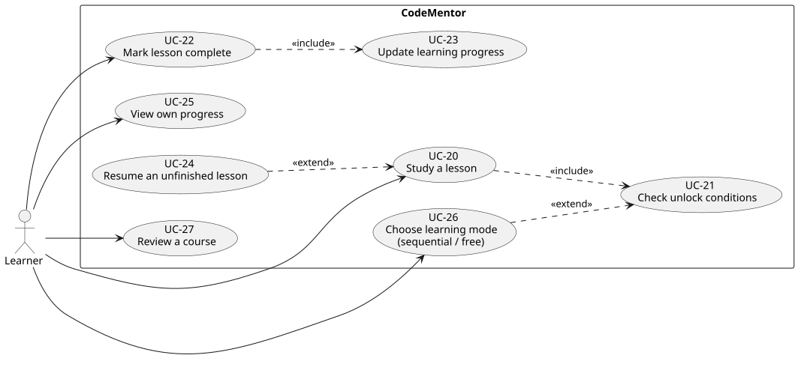

PlantUML source — edit here, then run <code>node scripts/render-diagrams.js</code>

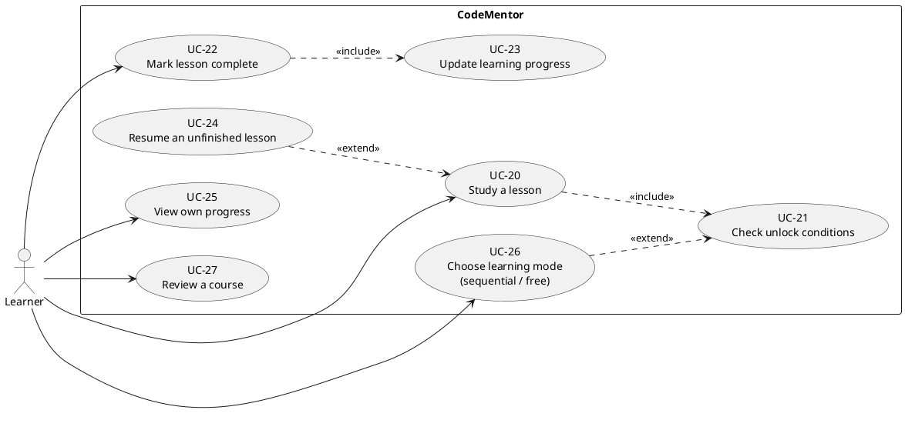

<!-- /diagram:p3-learning -->

| Code | Use case | Relationship | Data / implementation |
| --- | --- | --- | --- |
| UC-20 | Study a lesson | «include» UC-21 | `lessons`, Mongo `lesson_contents` |
| UC-21 | **Check unlock conditions** | *(included)* | `fn_lesson_available()` — fully replaces the old `isLocked` flag. Lesson level only: `fn_chapter_available` was removed in `0021` (it had no caller) |
| UC-22 | Mark lesson complete | «include» UC-23 | `lesson_progress.status='completed'` |
| UC-23 | **Update learning progress** | *(included)* | trigger `fn_refresh_course_progress` → `fn_refresh_roadmap_progress` |
| UC-24 | Resume an unfinished lesson | «extend» UC-20 — *cond: an `in_progress` lesson exists* | `idx_lesson_progress_active` |
| UC-25 | View own progress | | `course_enrollments.progress_percent` |
| UC-26 | Choose learning mode | «extend» UC-21 — *cond: the learner changes mode* | `course_enrollments.mode_override` |
| UC-27 | Review a course | | `course_reviews` → trigger updates `rating_avg` |

**Highlights for the defence:** UC-21 directly embodies the design decision "separate display order
from prerequisites". UC-26 embodies the requirement for *constrained / unconstrained learning*
without duplicating content.

---

## 6. P4 — Practice & grading

<!-- diagram:p4-practice -->
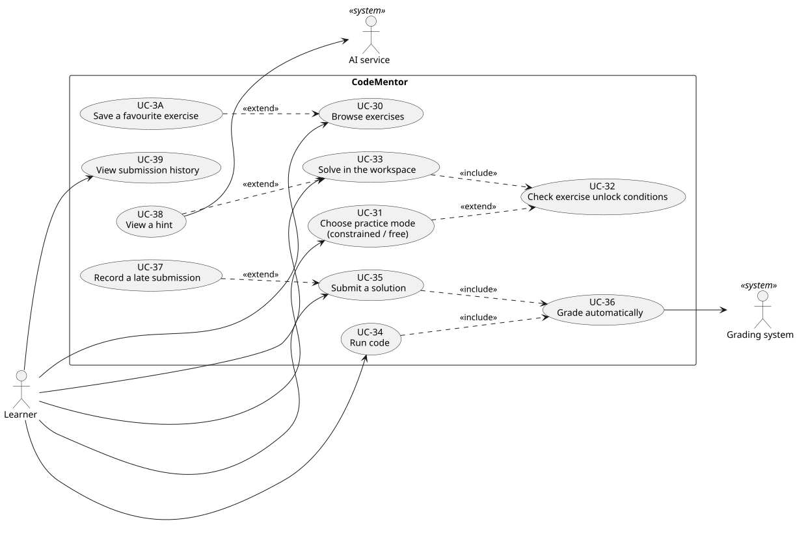

PlantUML source — edit here, then run <code>node scripts/render-diagrams.js</code>

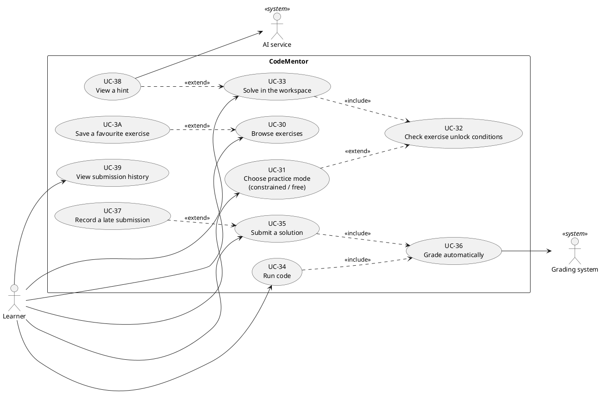

<!-- /diagram:p4-practice -->

| Code | Use case | Relationship | Data / implementation |
| --- | --- | --- | --- |
| UC-30 | Browse exercises | | `exercises`, `exercise_set_items` |
| UC-31 | Choose practice mode | «extend» UC-32 — *cond: the learner changes mode* | `exercise_set_enrollments.progression_mode_override` |
| UC-32 | **Check exercise unlock conditions** | *(included)* | `fn_exercise_available(user, set, exercise)` — the function and the `exercise_prerequisites` table were removed in `0021` (no caller); practice is currently not gated by earlier exercises |
| UC-33 | Solve in the workspace | «include» UC-32 | Mongo `exercise_contents` |
| UC-34 | Run code | «include» UC-36 | runs only `visibility='public'` tests |
| UC-35 | Submit a solution | «include» UC-36 | `submissions` |
| UC-36 | **Grade automatically** | *(included)* | Judge Service → `verdict`, `runtime_ms`, `memory_kb`, Mongo `submission_run_details` |
| UC-37 | Record a late submission | «extend» UC-35 — *cond: `now() > due_at AND allow_late_submission`* | `submissions.is_late` |
| UC-38 | View a hint | «extend» UC-33 — *cond: the learner asks* | Mongo `hints[].xpPenalty` |
| UC-39 | View submission history | | `idx_submissions_user_recent` |
| UC-3A | Save a favourite exercise | «extend» UC-30 | `exercise_progress.is_favorite` |

---

## 7. P5 — Content authoring & management

**Official** content (paths, courses, chapters, lessons, catalog exercises) belongs to the
**Administrator**. A **Learner** can only author **group-scoped** exercises — distinguished by the
precondition `exercises.owner_group_id`, not by the actor type. See
[`06-actors.md §3`](06-actors.md).

<!-- diagram:p5-authoring -->
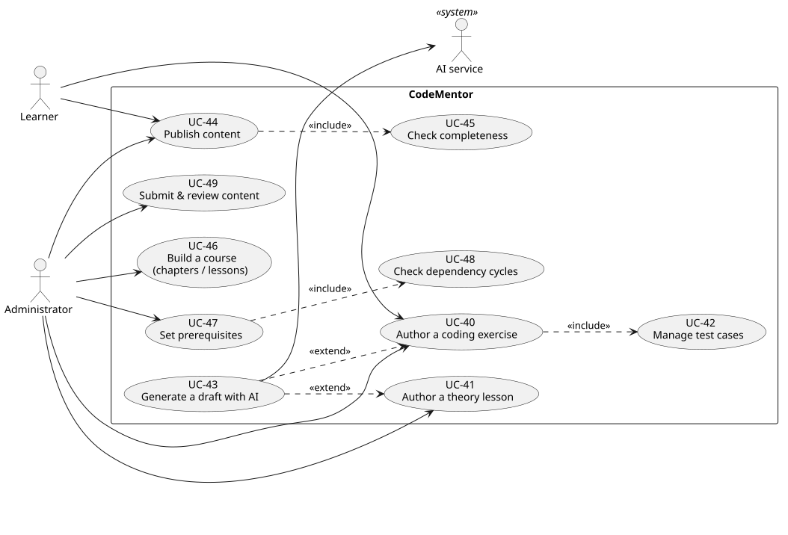

PlantUML source — edit here, then run <code>node scripts/render-diagrams.js</code>

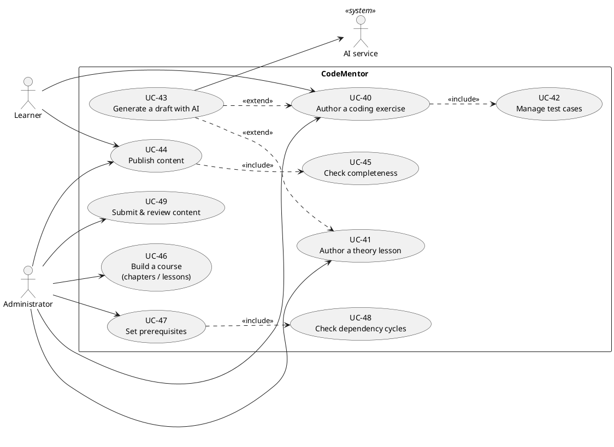

<!-- /diagram:p5-authoring -->

| Code | Use case | Actor | Relationship | Data |
| --- | --- | --- | --- | --- |
| UC-40 | Author a coding exercise | Administrator, Learner¹ | «include» UC-42 | `exercises`, Mongo `exercise_contents` |
| UC-41 | Author a theory lesson | Administrator | | `kind='theory'` |
| UC-42 | Manage test cases | *(included)* | | `testCases[]` (public/hidden, generated) |
| UC-43 | Generate a draft with AI | Administrator, Learner | «extend» UC-40, UC-41 — *cond: "Create with AI" is chosen* | `exercises.source='ai'` |
| UC-44 | Publish content | Administrator, Learner¹ | «include» UC-45 | `status='published'` |
| UC-45 | **Check completeness** | *(included)* | | CHECK `status<>'published' OR content_ref IS NOT NULL` |
| UC-46 | Build a course | Administrator | | `chapters`, `lessons` |
| UC-47 | Set prerequisites | Administrator | «include» UC-48 | Only `lesson_prerequisites` remains — 4 of the 5 `*_prerequisites` tables were removed in `0021` because no use case or DTO ever wrote to them |
| UC-48 | **Check dependency cycles** | *(included)* | | trigger `fn_prevent_dependency_cycle`, now attached only to `lesson_prerequisites` |
| UC-49 | Submit & review content | Administrator | | `exercise_status` (`pending_review` → `published`/`changes_requested`/`rejected`) |

¹ **A precondition decides the scope**, not the actor: `owner_group_id IS NULL` → shared catalog
(Administrator only); `owner_group_id = <group>` → group-internal (a Learner with the
`createExercise` permission).

---

## 8. P6 — Study groups

<!-- diagram:p6-groups -->
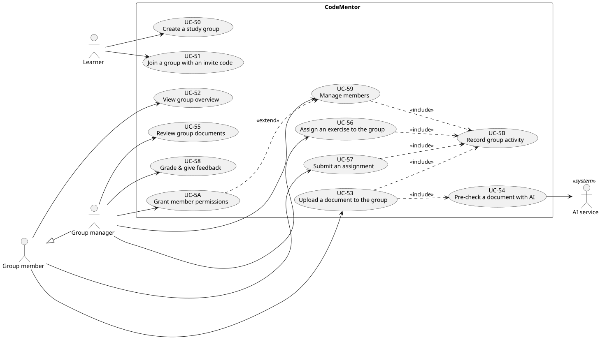

PlantUML source — edit here, then run <code>node scripts/render-diagrams.js</code>

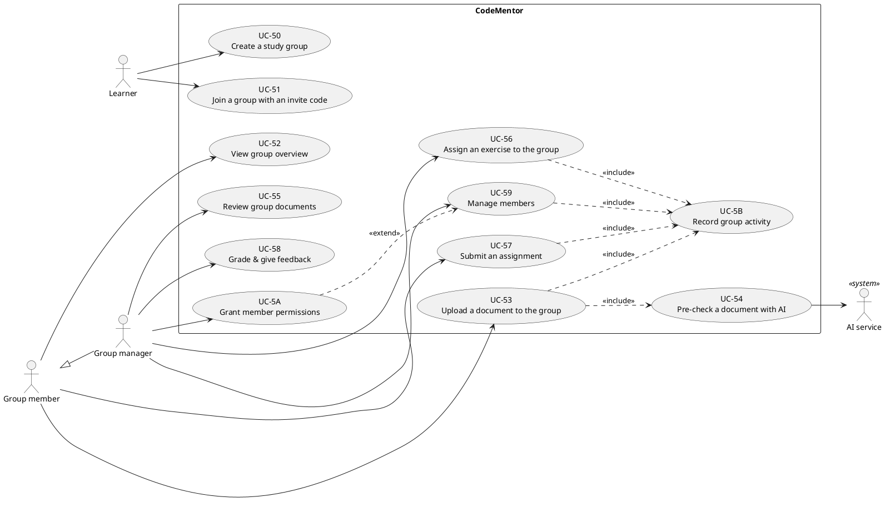

<!-- /diagram:p6-groups -->

| Code | Use case | Actor | Relationship | Data |
| --- | --- | --- | --- | --- |
| UC-50 | Create a study group | Learner → becomes Group manager | | `study_groups`, `group_members(role='owner')` |
| UC-51 | Join a group with an invite code | Learner | | `study_groups.invite_code` |
| UC-52 | View group overview | Member | | `member_count`, `submissionTrend` |
| UC-53 | Upload a document to the group | Member¹ | «include» UC-54, UC-5B | `group_documents` |
| UC-54 | **Pre-check a document with AI** | *(included)* | | `group_documents.ai_verdict` |
| UC-55 | Review group documents | Group manager¹ | | `document_status`, `reviewed_by` |
| UC-56 | Assign an exercise to the group | Group manager¹ | «include» UC-5B | `group_exercises`, `assignments` |
| UC-57 | Submit an assignment | Member | «include» UC-5B | `submissions.assignment_id` |
| UC-58 | Grade & give feedback | Group manager¹ | | `assignments.review_status/feedback` |
| UC-59 | Manage members | Group manager² | «include» UC-5B | `group_members` |
| UC-5A | Grant member permissions | Group manager² | «extend» UC-59 | `group_role_permissions` + `group_member_permissions` |
| UC-5B | **Record group activity** | *(included)* | | `group_activities` |

¹ **The precondition is a permission, not an actor.** UC-53 belongs to `Group member` but runs only
when `effectiveMemberPermissions(member).uploadDoc = true`. Someone who loses the `deleteDoc`
permission keeps their role. See [`06-actors.md §3`](06-actors.md).

² **Owner only** — precondition `group_members.role = 'owner'`. This is why the owner does not need
a separate actor: the only difference from a deputy lies in the preconditions of three use cases,
not in goals or functionality. The *exactly one owner per group* rule is enforced by the database
through `uq_group_members_single_owner`.

---

## 9. P7 — AI assistant

This package uses **generalization between use cases**: the four scenarios are specialisations of
one common interaction, not four separate use cases.

<!-- diagram:p7-ai -->
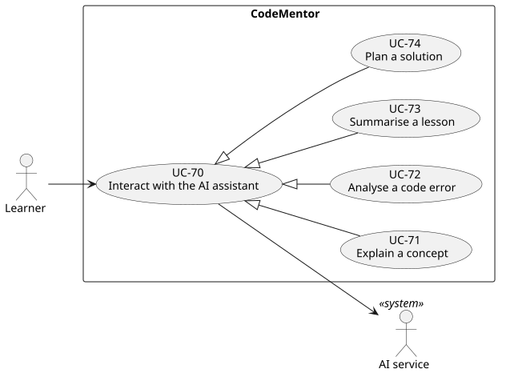

PlantUML source — edit here, then run <code>node scripts/render-diagrams.js</code>

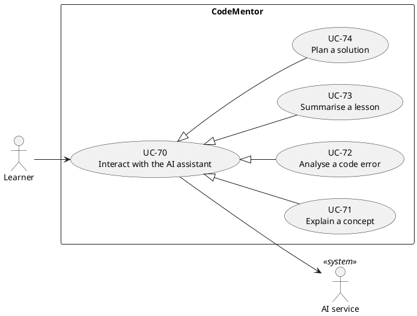

<!-- /diagram:p7-ai -->

| Code | Use case | Source in the frontend (UI label) |
| --- | --- | --- |
| UC-70 | Interact with the AI assistant *(parent)* | `/ai-tutor` |
| UC-71 | Explain a concept | *"Gỡ rối khái niệm — Diễn giải theo cách dễ hiểu"* |
| UC-72 | Analyse a code error | *"Phân tích lỗi code — Tìm nguyên nhân trước khi sửa"* |
| UC-73 | Summarise a lesson | *"Tóm tắt bài đang học — Rút ra ý chính"* |
| UC-74 | Plan a solution | *"Lập kế hoạch giải bài — Chia nhỏ bước tư duy"* |

UC-72 is also an extension point of UC-35 (Submit a solution) when `verdict <> 'accepted'`.

---

## 10. P8 — System administration

<!-- diagram:p8-admin -->
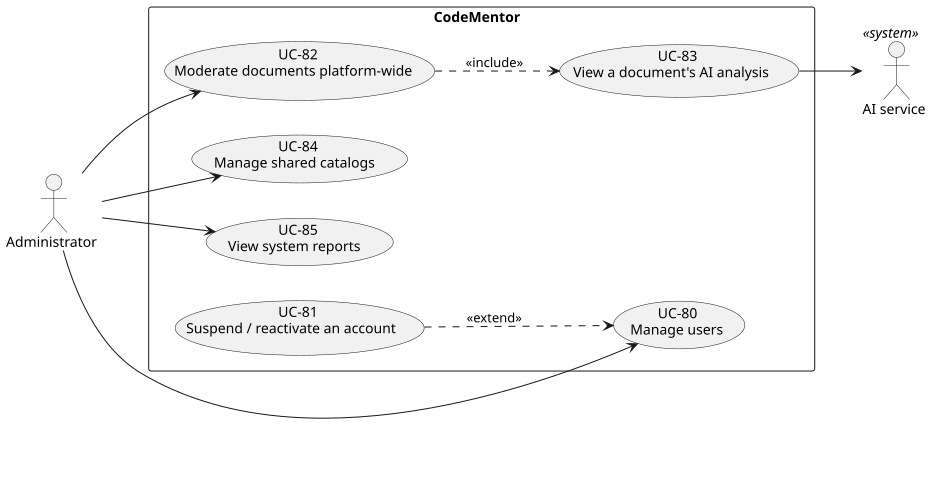

PlantUML source — edit here, then run <code>node scripts/render-diagrams.js</code>

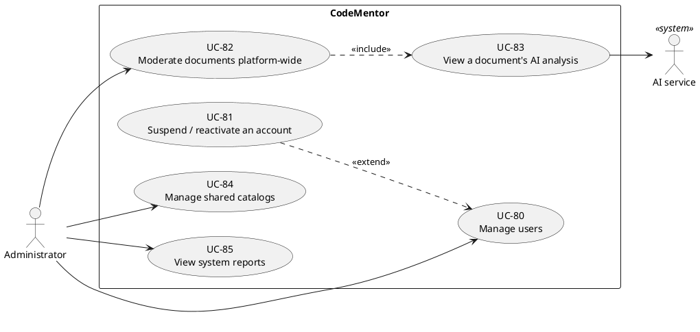

<!-- /diagram:p8-admin -->

| Code | Use case | Relationship | Data |
| --- | --- | --- | --- |
| UC-80 | Manage users | | `users.role/status` |
| UC-81 | Suspend / reactivate an account | «extend» UC-80 — *cond: a violation* | `account_status` |
| UC-82 | Moderate documents platform-wide | «include» UC-83 | `/admin`, `document_status` |
| UC-83 | **View a document's AI analysis** | *(included)* | `ai_verdict` |
| UC-84 | Manage shared catalogs | | `technologies`, `tags`, `companies` |
| UC-85 | View system reports | | the CACHE columns |

---

## 11. P9 — Automated tasks (time-triggered)

<!-- diagram:p9-scheduled -->
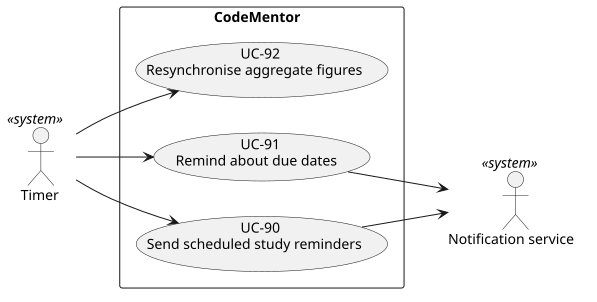

PlantUML source — edit here, then run <code>node scripts/render-diagrams.js</code>

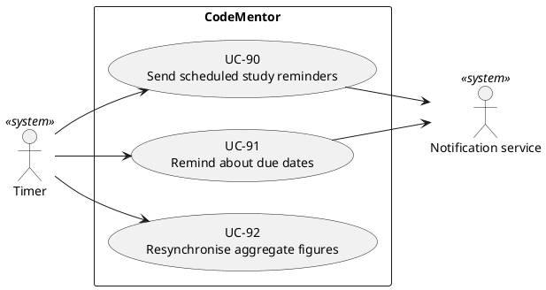

<!-- /diagram:p9-scheduled -->

| Code | Use case | Data |
| --- | --- | --- |
| UC-90 | Send scheduled study reminders | `study_schedule_slots` + `idx_study_schedule_due` |
| UC-91 | Remind about due dates | `group_exercises.due_at` |
| UC-92 | Resynchronise aggregate figures | `postgres/verify.sql` — reconciles caches with the source of truth |

---

## 12. Relationship summary

### 12.1 «include» — 14 relationships

| Base | → Included | Why it is **mandatory** |
| --- | --- | --- |
| UC-01, UC-03 | UC-04 Verify email | An unverified account cannot be used yet |
| UC-20 | UC-21 Check unlock conditions | Always checked before content is shown |
| UC-22 | UC-23 Update progress | Completing without updating progress is meaningless |
| UC-33 | UC-32 Check exercise unlock conditions | Same as UC-21 |
| UC-34, UC-35 | UC-36 Grade | No grading, no result |
| UC-40 | UC-42 Manage test cases | A coding exercise without test cases cannot be graded |
| UC-44 | UC-45 Check completeness | A database CHECK constraint |
| UC-47 | UC-48 Check cycles | A trigger; cannot be skipped |
| UC-53 | UC-54 AI pre-check | The `/admin` screen states documents are *analysed by the AI agent first* |
| UC-53, 56, 57, 59 | UC-5B Record activity | Every group action reaches the activity feed |
| UC-82 | UC-83 View AI analysis | Moderation decisions rely on the AI result |

### 12.2 «extend» — 13 relationships

| Extension | → Base | Condition (guard) |
| --- | --- | --- |
| UC-07 | UC-06 | `remindersEnabled = true` |
| UC-12 | UC-10, UC-11 | the user enters a keyword / picks a filter |
| UC-15 | UC-10 | `learning_preferences.completed_at IS NOT NULL` |
| UC-16 | UC-13, UC-14 | "Start learning" is clicked |
| UC-24 | UC-20 | an `in_progress` lesson exists |
| UC-26 | UC-21 | the learner changes learning mode |
| UC-31 | UC-32 | the learner changes practice mode |
| UC-37 | UC-35 | `now() > due_at AND allow_late_submission` |
| UC-38 | UC-33 | the learner opens a hint (costs XP) |
| UC-3A | UC-30 | "save as favourite" is clicked |
| UC-43 | UC-40, UC-41 | "Create with AI" is chosen |
| UC-5A | UC-59 | the permissions tab is opened |
| UC-81 | UC-80 | the account violated the rules |

### 12.3 Generalization between use cases

`UC-70 Interact with the AI assistant` ⊳ `UC-71`, `UC-72`, `UC-73`, `UC-74`.

---

## 13. Traceability matrix: use case → database

This table shows every use case has data behind it — and, conversely, that no table is unused.

| Use case | PostgreSQL tables | MongoDB collections | Functions / triggers |
| --- | --- | --- | --- |
| UC-01…05 | `users` | | |
| UC-06, 07 | `learning_preferences`, `study_schedule_slots` | | |
| UC-10…14 | `roadmaps`, `courses`, `chapters`, `lessons` | | |
| UC-15 | `learning_preferences`, `roadmap_technologies` | | |
| UC-16 | `roadmap_enrollments`, `course_enrollments` | | |
| UC-20 | `lessons` | `lesson_contents` | |
| **UC-21** | `lesson_prerequisites` | | `fn_lesson_available` (`chapter_prerequisites`/`fn_chapter_available` removed, `0021`) |
| UC-22, 23 | `lesson_progress` | | `fn_refresh_course_progress`, `fn_refresh_roadmap_progress` |
| UC-26 | `course_enrollments.mode_override` | | |
| UC-27 | `course_reviews` | | `fn_on_course_review_change` |
| UC-30 | `exercises`, `exercise_set_items` | | |
| UC-31 | `exercise_set_enrollments` | | |
| **UC-32** | ~~`exercise_prerequisites`~~ removed, `0021` | | ~~`fn_exercise_available`~~ removed, `0021` |
| UC-33, 38 | | `exercise_contents` | |
| UC-34…37 | `submissions`, `exercise_progress` | `submission_run_details` | |
| UC-40…43 | `exercises`, `exercise_tags` | `exercise_contents` | |
| UC-44, 45 | | | CHECK `exercises_published_needs_content` |
| UC-46 | `chapters`, `lessons` | | `fn_on_curriculum_change` |
| **UC-47, 48** | `lesson_prerequisites` (4 of 5 `*_prerequisites` tables removed, `0021`) | | `fn_prevent_dependency_cycle` |
| UC-50…52 | `study_groups`, `group_members` | | `fn_on_group_member_change` |
| UC-53…55 | `group_documents` | | |
| UC-56…58 | `group_exercises`, `assignments`, `submissions` | | |
| UC-59, 5A | `group_role_permissions`, `group_member_permissions` | | |
| UC-5B | `group_activities` | | |
| UC-70…74 | | | *(external service)* |
| UC-80…85 | `users`, `group_documents`, `technologies`, `tags` | | |
| UC-90, 91 | `study_schedule_slots`, `group_exercises.due_at` | | |
| UC-92 | | | `postgres/verify.sql` |

**Tables no use case uses:** `companies`, `exercise_companies` — exactly as warned in
[`04-design-decisions.md §11`](04-design-decisions.md). This is objective evidence for dropping
both tables, or for adding a *"Filter exercises by company"* use case if they are kept.
